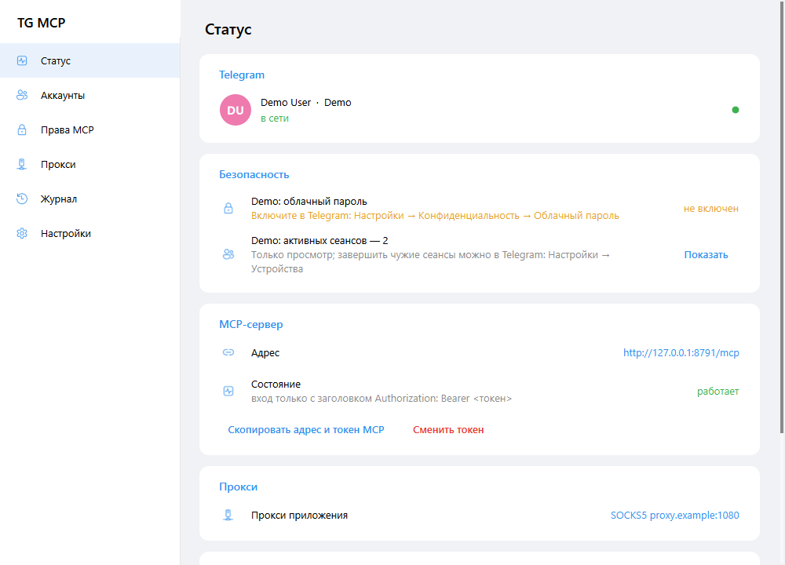
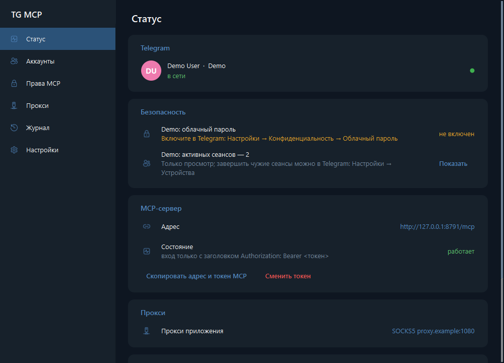
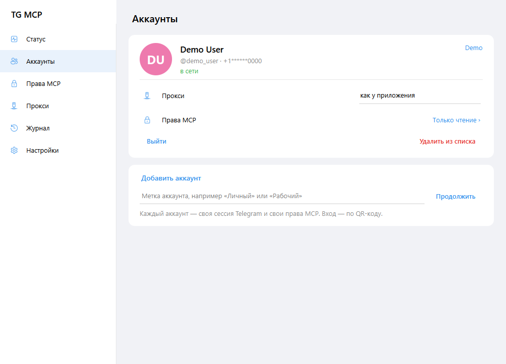
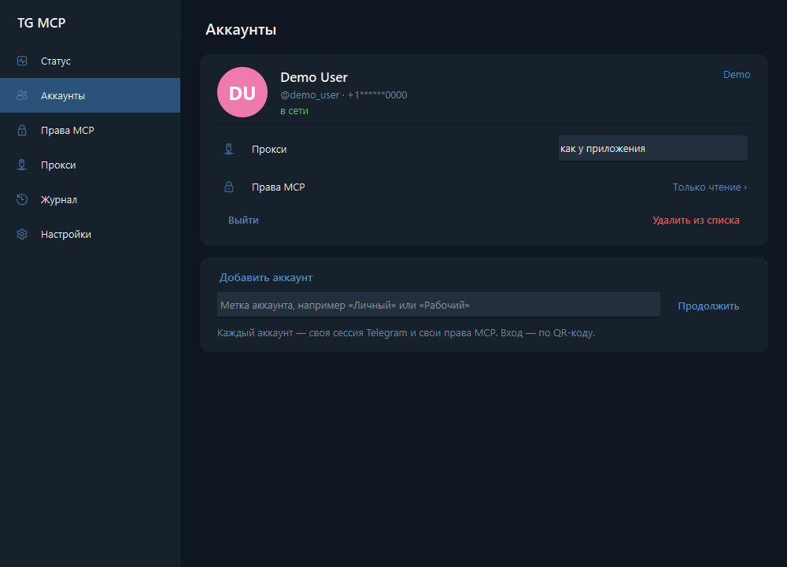
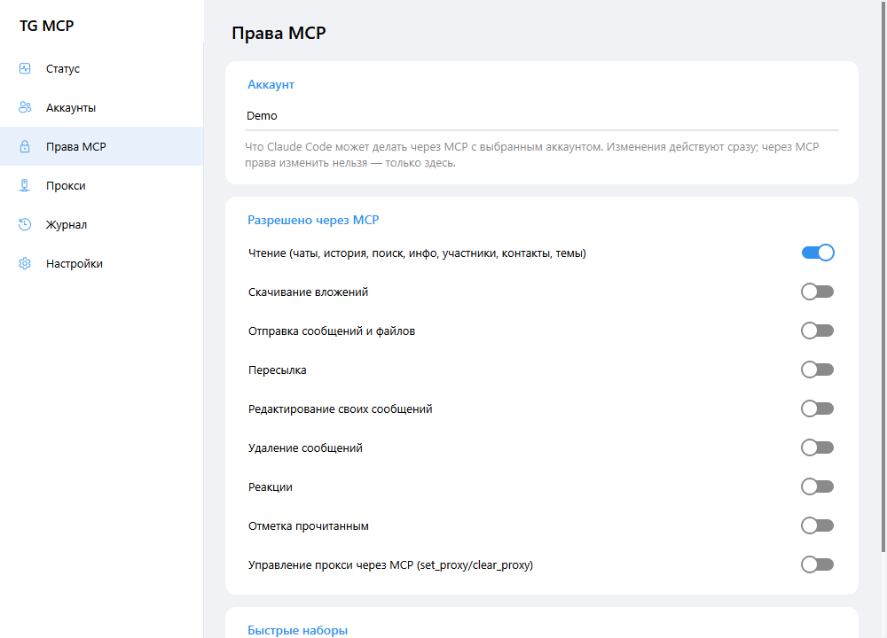
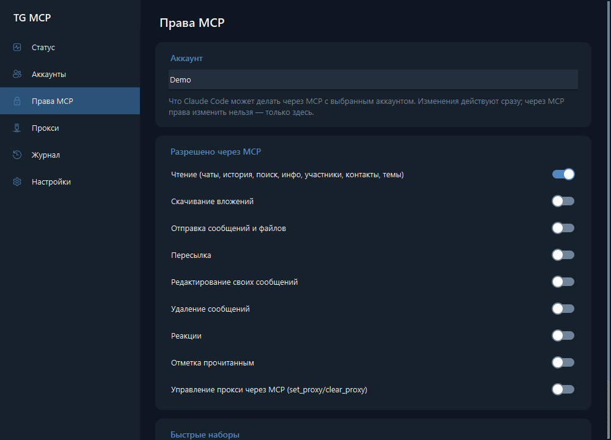
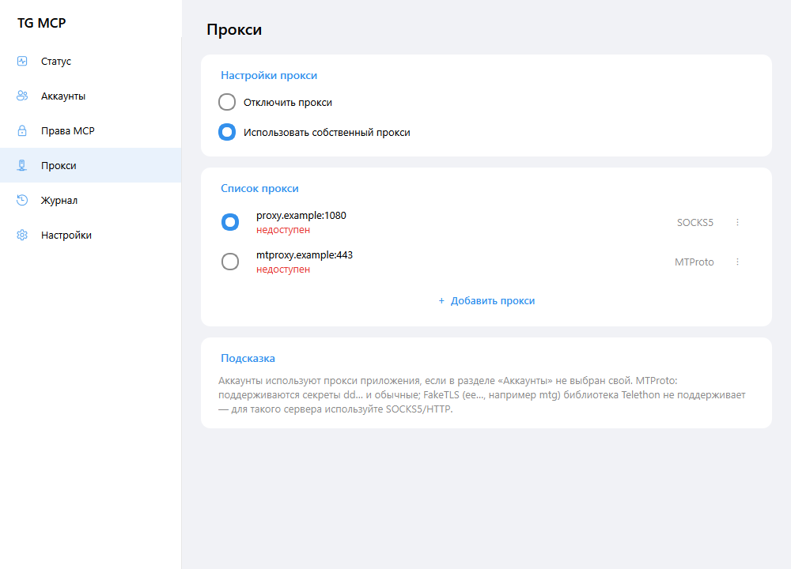
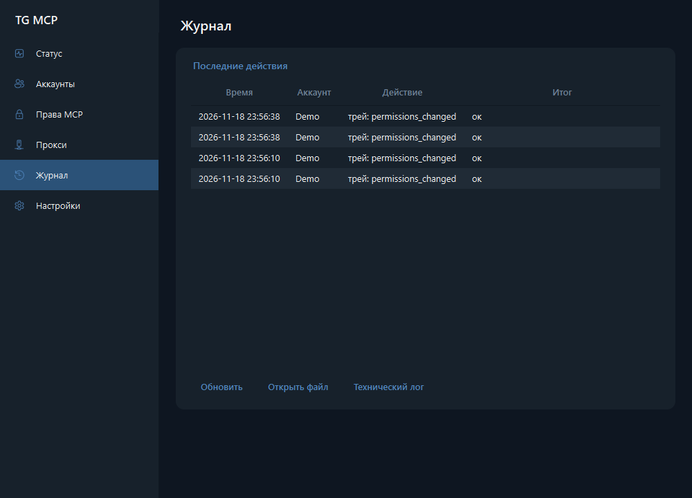

# TG MCP

[](https://github.com/chubajs12/tray-tg-mcp/releases/latest)
[](https://github.com/chubajs12/tray-tg-mcp/actions/workflows/release.yml)
[](LICENSE)

Фоновый клиент Telegram для **вашего собственного аккаунта** с MCP-сервером: Claude Code (и другие MCP-клиенты)
читает ваши чаты и выполняет операции — в пределах прав, которые вы сами выдали. Интерфейса чатов нет: только
окно настроек в стиле Telegram Desktop и иконка в трее. Windows, один `.exe`.

> Это неофициальный клиент Telegram на [Telethon](https://github.com/LonamiWebs/Telethon) (MTProto). Проект не
> связан с Telegram и не одобрен им. Используйте на свой риск и в соответствии с
> [Terms of Service](https://core.telegram.org/api/terms) Telegram API.

| Светлая тема | Темная тема |
|---|---|
|  |  |
|  |  |
|  |  |
|  |  |

## Возможности

- Несколько аккаунтов Telegram, у каждого своя сессия, свои права MCP и свой прокси.
- MCP-сервер на `127.0.0.1` (streamable HTTP, `/mcp`) с обязательным Bearer-токеном.
- Права по группам операций для каждого аккаунта; по умолчанию — **только чтение**. Менять права можно только в
  окне приложения, через MCP — нельзя.
- Клиент не показывает вас «в сети», не отправляет «печатает…», при чтении ничего не помечает прочитанным
  (только явный `mark_read`).
- Прокси: SOCKS5, HTTP, MTProto (обычные и `dd`-секреты); список прокси с проверкой доступности.
- Ключи сессий и `api_id`/`api_hash` — в Диспетчере учетных данных Windows (запасной вариант — файл, зашифрованный
  DPAPI), не в открытых файлах.
- Журнал всех действий MCP; ограничение частоты записи и учет FloodWait.
- «Статус» → «Безопасность»: включен ли облачный пароль и список активных сеансов аккаунта (только просмотр).

## Установка

1. Скачайте [TG-MCP.exe](https://github.com/chubajs12/tray-tg-mcp/releases/latest/download/TG-MCP.exe)
   (последняя версия; все версии — на странице [Releases](https://github.com/chubajs12/tray-tg-mcp/releases)) и
   при желании [TG-MCP.exe.sha256](https://github.com/chubajs12/tray-tg-mcp/releases/latest/download/TG-MCP.exe.sha256)
   для проверки целостности (см. «Проверка хеша» ниже).
2. Положите exe в любую папку и запустите. Установщика нет; данные хранятся в `%APPDATA%\TG MCP\`.
3. exe не подписан цифровой подписью, поэтому Windows SmartScreen при первом запуске покажет «Windows защитила
   ваш компьютер» → «Подробнее» → «Выполнить в любом случае». Некоторые антивирусы настороженно относятся к
   exe, собранным PyInstaller; если сомневаетесь — соберите сами из исходников (ниже).

### Проверка хеша

Положите `TG-MCP.exe` и `TG-MCP.exe.sha256` в одну папку и выполните там одну из команд.

PowerShell:

```powershell
$expected = (Get-Content .\TG-MCP.exe.sha256).Split(' ')[0]
$actual = (Get-FileHash .\TG-MCP.exe -Algorithm SHA256).Hash.ToLower()
if ($actual -eq $expected) { 'OK' } else { 'MISMATCH' }
```

Git Bash / WSL / Linux:

```bash
sha256sum -c TG-MCP.exe.sha256
```

Удаление: правый клик по иконке в трее → «Выход», удалите exe и при желании папку `%APPDATA%\TG MCP`. Перед этим
нажмите «Выйти» у аккаунтов (раздел «Аккаунты») — это завершит сеанс на сервере Telegram и удалит ключ сессии из
Диспетчера учетных данных; «Удалить из списка» делает то же самое и убирает аккаунт.

## Первый запуск

1. **api_id и api_hash.** При первом запуске окно откроется на «Настройках». Это ключи вашего собственного
   приложения Telegram:
   - откройте [my.telegram.org](https://my.telegram.org), войдите по номеру телефона (код придет в Telegram);
   - **API development tools** → **Create application**: App title и Short name — простое латинское имя без
     цифр и точек, Platform — Desktop, Description можно оставить пустым;
   - скопируйте **App api_id** и **App api_hash** в «Настройки» → «Сохранить».

   Если сайт отвечает «Too many attempts» или ERROR — попробуйте позже или с мобильного интернета: запросы через
   VPN и дата-центры часто отклоняются.
2. **Прокси** (если Telegram у вас доступен только через прокси): раздел «Прокси» → «Добавить прокси». Можно
   вставить ссылку `tg://proxy?...` или `t.me/socks?...`. MTProto-прокси с секретом FakeTLS (начинается с `ee`)
   не поддерживается библиотекой Telethon — используйте SOCKS5/HTTP или секрет `dd…`.
3. **Вход.** Раздел «Аккаунты» → метка (например «Личный») → «Продолжить» → отсканируйте QR-код в Telegram на
   телефоне: Настройки → Устройства → «Подключить устройство». Если включен облачный пароль — введите его в том
   же разделе (он нигде не сохраняется).
4. **Права MCP** — по умолчанию «Только чтение»; расширьте ровно настолько, насколько нужно.

## Подключение к Claude Code

«Статус» → «Скопировать адрес и токен MCP» — в буфере обмена окажется готовая команда:

```
claude mcp add --transport http tg http://127.0.0.1:8791/mcp --header "Authorization: Bearer <токен>"
```

Вариант для `.mcp.json`:

```json
{ "mcpServers": { "tg": { "type": "http", "url": "http://127.0.0.1:8791/mcp",
    "headers": { "Authorization": "Bearer <токен>" } } } }
```

Токен — секрет: не публикуйте его. «Сменить токен» в «Статусе» сразу отзывает старый.

## Инструменты MCP и права

У инструментов, работающих с аккаунтом, есть параметр `account` (метка, id или @username; можно не указывать, если
аккаунт один).

| Группа прав | Инструменты |
|---|---|
| — (всегда) | `list_accounts`, `get_permissions`, `get_proxy` |
| Чтение | `get_me`, `list_chats`, `get_messages`, `get_message`, `search_messages`, `list_topics`, `get_chat_info`, `get_participants`, `list_contacts`, `resolve` |
| Скачивание вложений | `download_media` |
| Отправка | `send_message`, `send_file` |
| Пересылка | `forward_messages` |
| Редактирование своих сообщений | `edit_message` |
| Удаление | `delete_messages` |
| Реакции | `send_reaction` |
| Отметка прочитанным | `mark_read` |
| Управление прокси через MCP | `set_proxy`, `clear_proxy` |

Права проверяются сервером при каждом вызове; запрещенный вызов возвращает понятную ошибку. В `tools/list` видны
все инструменты, потому что у разных аккаунтов права разные.

## Безопасность

- **Включите облачный пароль** (Telegram → Настройки → Конфиденциальность → Облачный пароль). «Статус» предупредит,
  если он выключен, и покажет активные сеансы.
- Выдавайте **минимум прав**. Отправка, удаление и пересылка от вашего имени — это действия ИИ-агента в вашем
  настоящем аккаунте.
- MCP-сервер слушает только `127.0.0.1` и требует токен. **Никому не передавайте токен** и не открывайте порт
  наружу.
- Все вызовы MCP пишутся в журнал (`%APPDATA%\TG MCP\actions.jsonl`): тексты отправленного — да, содержимое
  прочитанного — нет; пароли, секреты прокси и токен — никогда.
- Массовые рассылки и агрессивная автоматизация могут привести к FloodWait и ограничению или блокировке аккаунта.
  Приложение ограничивает частоту записи (~1 операция в секунду на аккаунт) и уважает FloodWait, но ответственность
  за сценарии использования — на вас.
- Это неофициальный клиент; Telegram может менять правила для сторонних приложений.

## Сборка из исходников

Нужен Python 3.13 (Windows).

```powershell
git clone https://github.com/chubajs12/tray-tg-mcp.git
cd tray-tg-mcp
python -m venv .venv
.venv\Scripts\python.exe -m pip install -r requirements-dev.txt
.venv\Scripts\python.exe -m pytest              # тесты
.venv\Scripts\pythonw.exe run.pyw --show         # запуск из исходников (данные — в .\data)
powershell -ExecutionPolicy Bypass -File build_exe.ps1   # сборка dist\TG MCP.exe + .sha256
```

Из исходников можно поставить и с ярлыком в меню Пуск: `install.ps1` (удаление — `uninstall.ps1`). Релизы
собираются GitHub Actions по тегу `v*` ([.github/workflows/release.yml](.github/workflows/release.yml)).

Служебные параметры: `--show` — открыть окно; `--quit` — штатно закрыть запущенный экземпляр; `--diag <файл>` —
проверка окружения (хранилище ключей, версии библиотек) без подключения к Telegram.

## Лицензия

[MIT](LICENSE). Сторонние компоненты и их лицензии (в том числе Qt/PySide6 под LGPL-3.0) —
[THIRD_PARTY_NOTICES.md](THIRD_PARTY_NOTICES.md).

---

## English (short)

**TG MCP** is a background Telegram client for **your own account** with an MCP server, so Claude Code (or any MCP
client) can read your chats and act on your behalf — strictly within per-account permissions you grant in the app
(read-only by default; permissions cannot be changed over MCP). No chat UI: a Telegram-Desktop-styled settings
window and a tray icon. Windows, single `.exe`. Unofficial client built on Telethon; not affiliated with Telegram.

- **Install:** download [TG-MCP.exe](https://github.com/chubajs12/tray-tg-mcp/releases/latest/download/TG-MCP.exe)
  (all versions: [Releases](https://github.com/chubajs12/tray-tg-mcp/releases)) and run it (unsigned — SmartScreen:
  *More info → Run anyway*). Verify: `sha256sum -c TG-MCP.exe.sha256`, or compare
  `(Get-FileHash .\TG-MCP.exe).Hash` with the first field of `TG-MCP.exe.sha256` in PowerShell.
  Data lives in `%APPDATA%\TG MCP\`; session keys and `api_id`/`api_hash` are stored in Windows Credential Manager.
- **First run:** create your own `api_id`/`api_hash` at [my.telegram.org](https://my.telegram.org) (API development
  tools → Create application, Platform: Desktop) and paste them in *Settings*; add a proxy if needed (SOCKS5/HTTP/
  MTProto; FakeTLS `ee…` secrets are not supported by Telethon); add an account and scan the QR code
  (Telegram → Settings → Devices → Link Desktop Device); adjust MCP permissions.
- **Connect:** *Status* → *Copy MCP address and token* →
  `claude mcp add --transport http tg http://127.0.0.1:8791/mcp --header "Authorization: Bearer <token>"`.
- **Security:** enable your Telegram cloud password, grant minimal permissions, never share the token, mind flood
  limits — automation can get an account restricted. All MCP calls are logged (sent texts yes, read content no).
- **Build:** Python 3.13, `python -m venv .venv`, `pip install -r requirements-dev.txt`, `pytest`,
  `build_exe.ps1`. Releases are built by GitHub Actions on `v*` tags.
- **License:** MIT; third-party notices (incl. Qt/PySide6, LGPL-3.0) in `THIRD_PARTY_NOTICES.md`.
